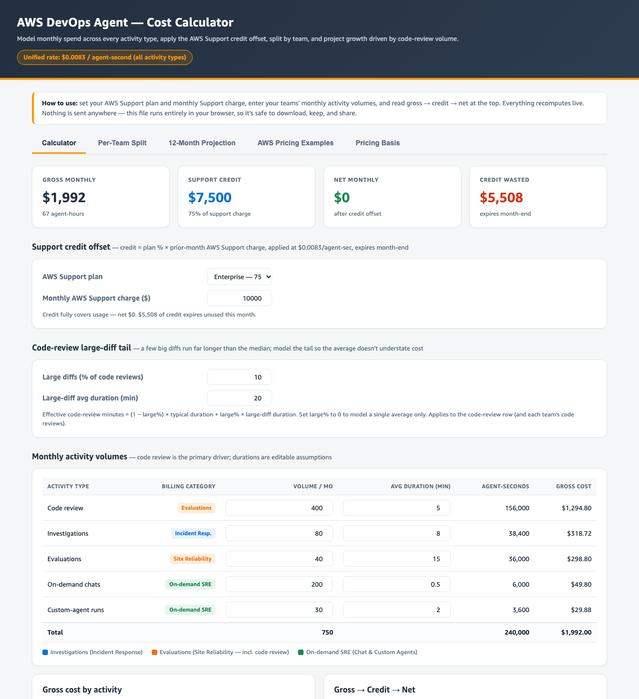

# AWS DevOps Agent — Cost Calculator

An interactive, single-file calculator for estimating [AWS DevOps Agent](https://aws.amazon.com/devops-agent/) cost. Set your AWS Support plan and monthly Support charge, enter your teams' monthly activity volumes, and read gross → credit → net spend live. Includes a per-team split, a 12-month projection, and the worked examples from AWS's published pricing page.

**▶ Live calculator:** https://<your-username>.github.io/<repo-name>/

It's a single self-contained HTML file — no dependencies, no tracking, no network calls. It runs entirely in your browser, so you can download it and share it freely.

## How it works

Every DevOps Agent activity bills at **$0.0083 / agent-second** ( = $0.498 / agent-minute = $29.88 / agent-hour). Customers on paid AWS Support plans receive monthly credits that offset usage — 100% (Unified Operations), 75% (Enterprise), or 30% (Business+) of the prior month's AWS Support charge — which expire at month-end. The calculator applies that offset: `net = max(0, usage − credit)`.

## Estimates only

Based on public AWS pricing as of September 2026. Rates, Support-credit percentages, and free-trial terms can change — confirm current pricing at the [AWS DevOps Agent pricing page](https://aws.amazon.com/devops-agent/pricing/) and the [AWS Pricing Calculator](https://calculator.aws/), and verify actual usage in your Cost & Usage Reports, before making commitments.
